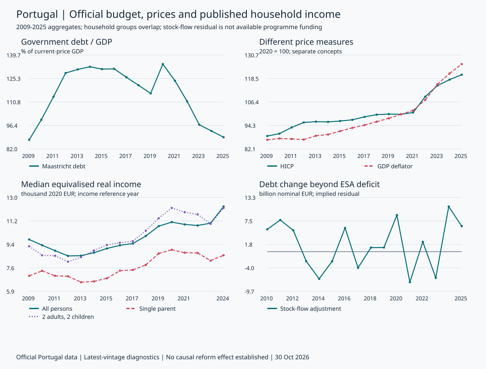
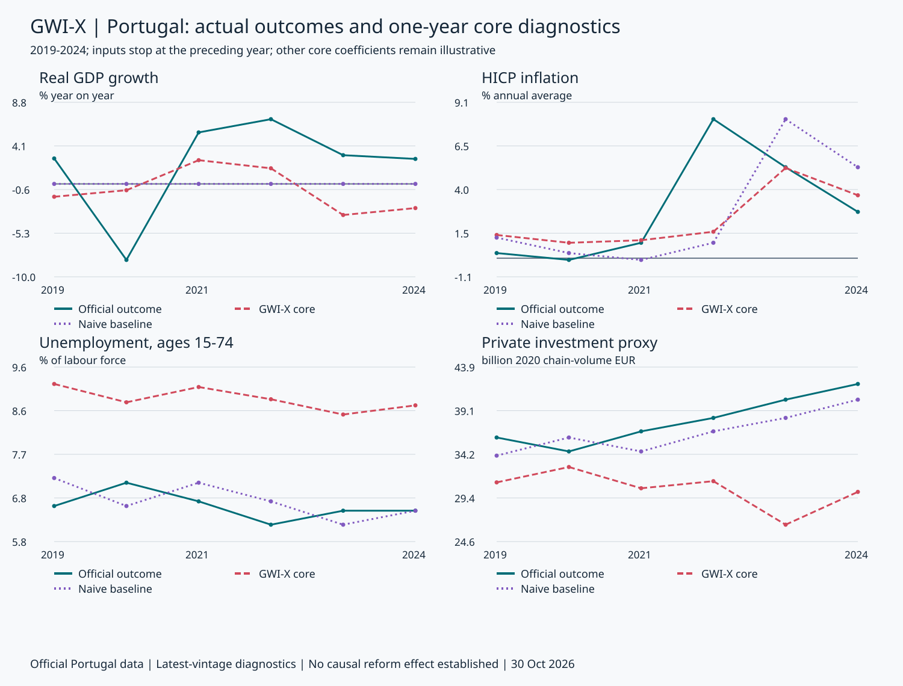

# GWI-X: реальные данные Португалии выявили границы модели

Дополнение к синтетической версии v1.2. Снимок официальных источников загружен 30 октября 2026 года; наблюдаемые годовые периоды — 2009–2025. Исходный синтетический отчёт описывает отдельный эксперимент и не является результатом проверки на Португалии.

## Что установлено

Открытые базы Eurostat, Banco de Portugal и ЕЦБ подключены: {{QUERIES}} успешных запросов, {{SERIES}} годовой ряд, {{OBSERVED}} числовых значений и {{MISSING}} явных пропусков. Для ставки ЕЦБ использованы 6 209 реальных дневных наблюдений; годовые средние допускаются только при полном календарном покрытии.

Все 34 проверки бюджетного баланса и номинального ВВП сошлись в пределах округления официальных публикаций. Однако текущие параметры ядра на 2019–2024 годах дают более высокие средние ошибки роста ВВП, безработицы, инвестиционного приближения и ставки денежной политики, чем простые ориентиры. Для HICP ошибка ниже ориентира на этой небольшой выборке. Это основание для дальнейшей калибровки и проверки, а не подтверждение эффективности GWI-X.

Полная национальная микросимуляция и расчёт реформы **заблокированы**: нет лицензированных наблюдаемых микроданных, проверенного португальского налогово-социального модуля, подтверждённого финансирования и кассового моста. Неизвестные суммы финансирования и резерва равны `null`. Дополнительные расходы программы в этом расчёте — 0; выплаты не исполнялись.

## Что подключено и что ещё требуется

| Контур | Источник и доступ | Фактическое использование |
|---|---|---|
| ВВП, потребление, инвестиции, зарплаты | Eurostat `nama_10_gdp`, открытый JSON-stat | Номинальные счета и отдельные цепные объёмы 2020 года; бухгалтерская сверка, лаговые входы макроядра |
| Государственные доходы, расходы, проценты, пособия, взносы, налоги | Eurostat `gov_10a_main`, сектор S.13 | 9 рядов агрегатов на основе ESA 2010; не персональные налоговые начисления и не казначейская касса |
| Государственный долг | Eurostat `gov_10dd_edpt1` | Консолидированный валовой долг по Маастрихтскому определению на конец года |
| Потребительские цены | Eurostat `prc_hicp_aind`, CP00 | Годовые HICP и инфляция; зафиксированный исторический ECOICOP до 2025 года |
| Занятость и безработица | Eurostat `lfsi_emp_a`, `une_rt_a` | Занятость 20–64 к населению; отдельно безработица 15–74 к рабочей силе. Знаменатели не смешиваются |
| Доходы семей | Eurostat `ilc_di03`, `ilc_di04`, `nasa_10_nf_tr` | Опубликованные медианы/средние эквивалентного дохода и национальный располагаемый доход; не индивидуальные семьи |
| Капитал и производительность | Eurostat `nama_10_nfa_st`, `nama_10_lp_ulc` | Чистые основные фонды и производительность труда. Производительность труда не объявляется TFP |
| Население | Eurostat `demo_pjan` | Численность на 1 января; не годовая средняя и не число домохозяйств |
| Наблюдаемая стоимость долга | BPstat, серия `13169604` | Опубликованная неявная годовая ставка; не предложение кредитования GWI-X |
| Денежная политика | ЕЦБ `FM.D.U2.EUR.4F.KR.MRR_FR.LEV` | Календарные средние реальной ставки основных операций рефинансирования еврозоны; не доходность португальского госдолга |
| Реальные микроданные | EU-SILC scientific-use files / исследовательский доступ INE | **Не получены.** Реализован локальный аудит канонической лицензированной выгрузки, проверенный только на явно синтетических тестовых фикстурах |
| Национальные правила | IRS / Segurança Social / национальный пакет EUROMOD | **Не реализованы и не проверены.** Синтетические ставки не заменяют португальское законодательство |
| Касса и обязательства программы | Исполнение бюджета, финансовые счета, документы об ассигнованиях, реестры утверждённых обязательств | **Не подключены.** Новые фонды GWI-X не существуют в опубликованной статистике как подтверждённые счета |

Названия отсутствующих источников описывают требуемые основания; они не означают, что получен доступ к закрытым реестрам. Присоединение всех баз мира для этого эксперимента не требуется. Национальные правила и микроданные нужны именно для проверки индивидуальных налогов, пособий и EMTR.

## Проверка бюджетных потоков

Для каждого из 17 лет проверено `TR − TE = B9`: положительное B9 означает чистое кредитование/профицит. Допуск 150 тыс. EUR соответствует трём значениям, округлённым до 0,1 млн EUR. Это допуск публикации, отдельный от строгого денежного инварианта синтетического ядра.

Для номинального ВВП проверено `Y = C(S14+S15) + G(S13) + GFCF + изменение запасов/ценностей + X − M + статистическое расхождение`. Все компоненты взяты в текущих ценах. Допуск 400 тыс. EUR соответствует округлению восьми опубликованных величин. Цепные объёмы не складываются как точное национальное тождество вне базового года.

Десятилетний исторический срез 2016–2025 присутствует в [таблице долговых потоков](../real-data/PT/2026-10-30-final/debt_stock_flow.csv). В 2024 году долг вырос на 8,970 млрд EUR при профиците ESA 2,107 млрд EUR. Расчётный остаток между изменением долга и дефицитом — 11,077 млрд EUR. Он включает финансовые операции и прочие корректировки; его состав здесь не расшифрован и **он не является ресурсом GWI-X**.

Кассовый `fiscal.settle` не вызывается с начисленными доходами ESA как с реальными казначейскими поступлениями. Для национального запуска сначала нужны кассовое исполнение, финансовые активы/обязательства и график погашений. Источник [Eurostat о связи дефицита и долга](https://ec.europa.eu/eurostat/cache/metadata/en/gov_10dd_esms.htm) прямо описывает такие различия.



## Историческая диагностика исполняет существующее ядро

Для каждого года 2019–2024 вызывается `gwix.macro.advance`. Состояние переинициализируется наблюдениями предыдущего года; прогнозируемый факт текущего года не используется в его собственном прогнозе. Оценка инвестиционной доли использует только 2010–2018 годы. Остальные макрокоэффициенты остаются иллюстративными параметрами v1.2. После получения результатов параметры по проверочной выборке не подбирались.

Потребление и государственные расходы в цепных объёмах предыдущего года удерживаются неизменными на один шаг. Публичные инвестиции приближённо дефлируются дефлятором ВВП предыдущего года. Прочий спрос фиксируется по остатку 2018 года, включая неаддитивность цепных объёмов; это не наблюдаемый чистый экспорт. Чистые основные фонды включают жильё и лишь приближают производительный капитал ядра. Потенциальный выпуск для начального состояния равен прошлому ВВП, начальный разрыв — 0, налоговый стимул — нейтральные 0,65. Это явные допущения диагностического опыта, а не наблюдаемые факты.

Использованы последние доступные на дату загрузки версии исторических данных, включая пересмотры и предварительные наблюдения. Это ретроспективная диагностика, **не прогноз с исторически доступным информационным набором**, не структурная идентификация и не десятилетний прогноз Португалии. Для 2025 года годовой шаг не оценён: отсутствует наблюдение капитала за 2024 год. Для капитала оценены пять исходов 2019–2023.

MAE — средняя абсолютная ошибка. Ориентир для роста ВВП — нулевой рост, для остальных величин — уровень предыдущего года. Каждый показатель имеет собственную единицу; ошибки разных строк не суммируются.

| Показатель | Наблюдений | MAE ядра | MAE ориентира | Ошибка ядра |
|---|---:|---:|---:|---|
{{METRICS}}

Небольшая выборка включает сильные колебания; доверительные интервалы и доказательства причинного эффекта не рассчитывались. Результат по инфляции не доказывает, что GWI-X уменьшит инфляцию: реформа в этом историческом опыте вообще не вводилась. Для безработицы использовано математическое ожидание тех же вероятностей перехода, что и в ядре, при неизменной прошлой рабочей силе; входа/выхода из активности и реальной индивидуальной панели нет.



## Доходы домохозяйств: что можно проверить

Сохранены реальные опубликованные эквивалентные доходы. Для Португалии доход EU-SILC относится к году перед годом обследования: запись обследования 2025 сопоставляется с HICP 2024, а не с HICP 2025. Значение в ценах 2020 года равно `доход × HICP(2020) / HICP(год дохода)`. Дефлятор ВВП хранится отдельно и не подменяет потребительский индекс. [Метаданные EU-SILC](https://ec.europa.eu/eurostat/cache/metadata/en/ilc_sieusilc.htm) описывают доход и референтные периоды.

Медианы не складываются и не умножаются на число семей для восстановления бюджета. Группы опубликованной статистики могут перекрываться. A1 — один взрослый, A1_DCH — один взрослый с зависимыми детьми, A2_DCH2 — два взрослых с двумя зависимыми детьми. Возрастная категория A1_GE65 не равна всем пенсионерам; выбранный ряд для Португалии пуст во всём окне и оставлен пустым. Самозанятость и инвалидность не восстановлены из этих медиан.

[Публичные микрофайлы EU-SILC](https://ec.europa.eu/eurostat/web/microdata/public-microdata/statistics-on-income-and-living-conditions) являются полностью синтетическими и непригодны для статистических выводов о населении. Поэтому они не скачивались как реальные семейные записи. Для индивидуальных валовых/чистых доходов, пособий, занятости и EMTR необходимы [исследовательские микроданные и условия доступа Eurostat](https://ec.europa.eu/eurostat/web/microdata/access), сопоставленные по волне национальные правила и проверка прав на использование. Учётный аудит канонической выгрузки не заменяет этот этап и не проверен на лицензированных данных.

## Воспроизводимость и данные

Исходные ответы API сохранены побайтно в `data/official/PT/2026-10-30-final/raw/`; Git не меняет окончания строк этих файлов. Для каждого запроса сохранены URL, время загрузки, статус HTTP, версия/обновление источника, размер и SHA-256. TLS проверяется; отключения проверки сертификатов нет. У ECB дата обновления источника неизвестна (`null`), отдельно известно время загрузки. Контрольные суммы подтверждают целостность сохранённого снимка, но не заменяют доверие к самому статистическому источнику.

Идентификатор снимка: `{{SNAPSHOT}}`.

`real-data/PT/2026-10-30-final/official.sqlite` — настоящая локальная реляционная база открытых агрегатов. Числа сохранены десятичными строками, пропуски — SQL `NULL`; запросы связаны с наблюдениями внешним ключом. Изменения/удаления наблюдений запрещены триггерами. Новый импорт создаёт новую базу, существующая не перезаписывается. Это подключение к опубликованным API и локальная база доказательств, не доступ к внутренним серверам государственных органов.

Первая попытка загрузки сохранена отдельно и содержит сетевую недоступность ряда производительности; окончательный снимок успешно получил этот ряд. Никакой запасной синтетической серии не подставлялось. В окончательном снимке 17 пропусков A1_GE65 и два пропуска капитала за 2024–2025 годы. Все 19 значений остаются `NULL`.

```text
python -S -m gwix.official fetch --out results-local/new-official-snapshot
python -S -m gwix.official validate --snapshot results-local/new-official-snapshot --out results-local/new-official-check
python -S scripts/audit_official.py results-local/new-official-snapshot results-local/new-official-check
python -S scripts/verify_official.py --out results-local/offline-replay
python -S -m unittest discover -s tests -v
python -S -m gwix.official run-policy
```

`fetch` требует сеть и возвращает 2 при недоступности источника, сохраняя протокол. `validate` работает без сети; его код 0 означает завершённую проверку данных/счетов, **не пригодность модели и не разрешение реформы**. `run-policy` возвращает 2 и перечисляет недостающие условия. Устанавливать сервер БД или сторонние библиотеки для расчётов не требуется.

75 тестов проверяют прежние инварианты, единицы/схемы, различие нуля и пропуска, исключение прогнозных значений, целостность снимка, границы обучения, отсутствие данных текущего целевого года в его прогнозе, закрытый запуск при неизвестном финансировании, приватность локальной выгрузки и точность SQLite. Независимый скрипт без импорта расчётного ядра сверяет 697 строк CSV с SQLite, напрямую сопоставляет 68 значений с сырыми ответами API и пересчитывает 17 бюджетных балансов. Эти проверки не являются эмпирическим подтверждением социальной или макроэкономической политики.

## Что необходимо сделать до реальной оценки реформы

1. Получить разрешённую исследовательскую микровыборку Португалии и сопоставить охват, веса, год дохода и определения с опубликованными агрегатами.
2. Реализовать или подключить проверенный национальный налогово-социальный модуль для конкретного года, включая совместное налогообложение, вычеты, взносы, доходные/имущественные тесты пособий и национальные контрольные примеры.
3. Получить реальные документы о ресурсе программы, владельце резерва, существующих обязательствах и допустимых заимствованиях; связать кассу, начисления и долг.
4. Переоценить и проверить на отдельном периоде спрос, инвестиции, активность, переходы занятости, цены и денежную политику еврозоны. Отдельно проверить чувствительность к составу капитала и внешнему сектору.

Пока эти условия не выполнены, система пригодна для воспроизводимых исследовательских проверок и выявления ограничений. Эффект GWI-X на Португалию или мировую экономику не установлен.

## Первичные источники

- [Документация API Eurostat](https://ec.europa.eu/eurostat/web/user-guides/data-browser/api-data-access/api-detailed-guidelines/api-statistics).
- [Метаданные государственных счетов ESA 2010](https://ec.europa.eu/eurostat/cache/metadata/en/gov_10a_main_esms.htm).
- [Государственный дефицит, долг и финансовые корректировки](https://ec.europa.eu/eurostat/cache/metadata/en/gov_10dd_esms.htm).
- [HICP: определение и изменение классификации с 2026 года](https://ec.europa.eu/eurostat/cache/metadata/en/prc_hicp_esms.htm).
- [API Banco de Portugal](https://bpstat.bportugal.pt/api/media/files/scripts/menu/api.html?control_kebab=1).
- [Документация API ЕЦБ](https://data.ecb.europa.eu/help/api/data).
- [Точные запросы и выбранные размерности](../data/official/PT/2026-10-30-final/queries.json), [протоколы фактической загрузки](../data/official/PT/2026-10-30-final/receipts.json), [полнота рядов](../real-data/PT/2026-10-30-final/coverage.csv).
