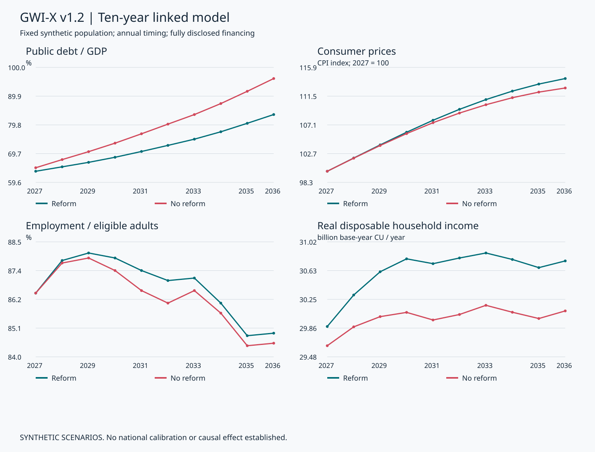
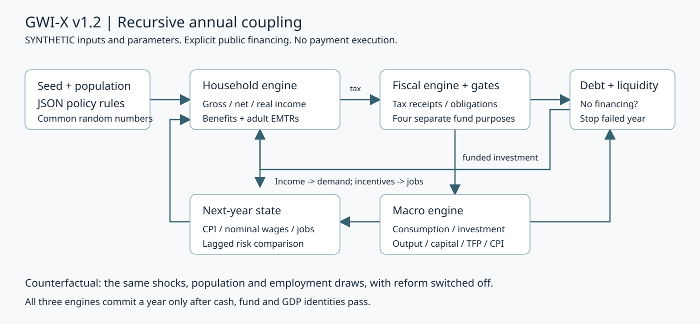
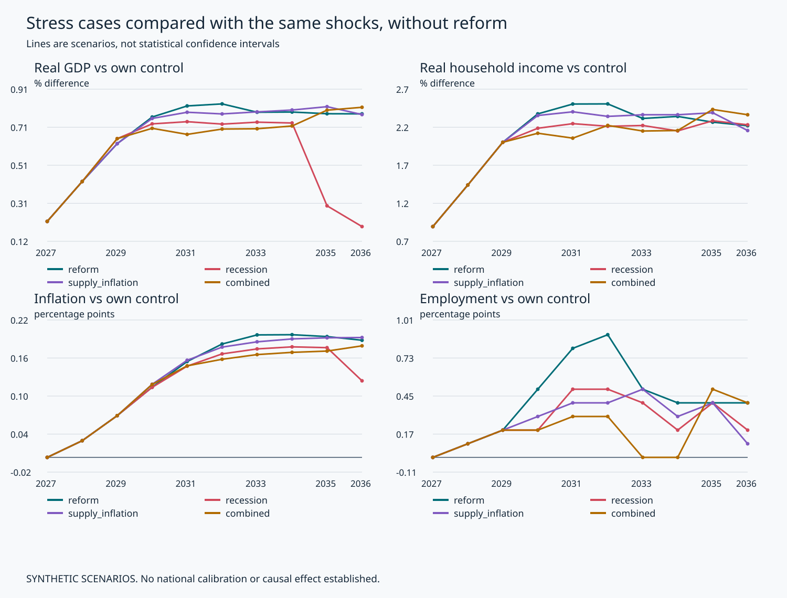
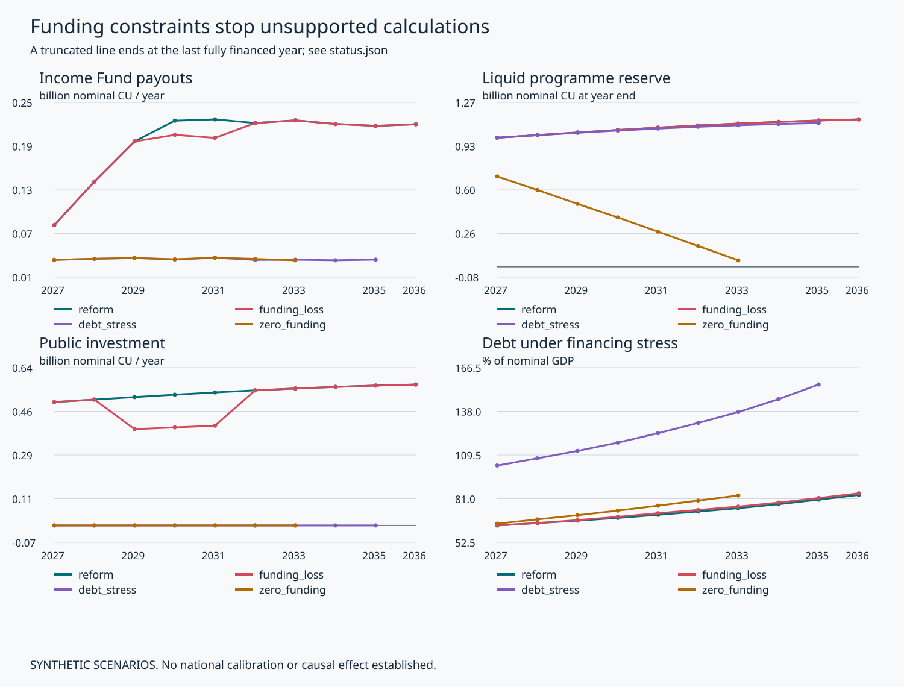

# GWI-X v1.2: три связанные модели и границы финансового покрытия

Технический отчёт · 29 октября 2026 года · Python 3.11+ · горизонт 2027–2036.

**Все исходные данные и коэффициенты синтетические. Это сценарный вычислительный эксперимент, а не прогноз страны и не доказательство эффекта на мировую экономику.** Научная валидация причинных связей, национальная калибровка и правовая проверка не выполнялись.

## 1. Что получилось

Реализованы национальный бюджет с долгом и ликвидностью, микросимуляция доходов и занятости семей и рекурсивная макроэкономическая динамика. Модули используют одни и те же доходы, взносы, обязательства, цены и инвестиции. Тождества проверяются до фиксации каждого года.

В базовом синтетическом варианте к 2036 году реальные располагаемые доходы семей выше контроля на 2.23%, выпуск — на 0.78%, а доля занятости — на 0.40 п.п. Инфляция при этом **выше**, а не ниже контроля, на 0.18 п.п. Долг составляет 83.43% ВВП против 96.06% без реформы; относительно исходных 60% он всё равно растёт. Эти значения характеризуют только выбранные допущения.

Программа не создаёт бесплатного ресурса: финансирование отнимается у существующего условного пула субсидий фирмам. Нераспределённая часть возвращается казначейству. Поэтому улучшение относительного показателя долга нельзя целиком приписывать росту производительности или благосостояния. В самой реальной политике отмена субсидий потребует проверки прав, контрактов и последствий для фирм и занятости.



Линии отражают расчётные траектории. Сравнение «реформа / без реформы» использует одну и ту же синтетическую исходную популяцию, шоки и случайные числа. Более высокая занятость относительно контроля не означает роста занятости относительно начального года.

## 2. Архитектура и время



Порядок одного года:

1. Из предыдущего состояния приходят CPI, реальные контрактные ставки, производительный капитал, TFP, разрыв выпуска и стимулы к труду. Со второго года происходят индивидуальные переходы занятости.
2. Микромодель вычисляет начисления, личные налоги, взносы, действующие пособия и стоимость уже назначенной группы GWI-X.
3. Контроллер проверяет ресурс, многолетнее покрытие, долг и относительные риски. Новые назначения получают только допустимые семьи. Уже назначенная группа не отменяется из-за закрытия gate.
4. Фонды финансируют надбавки, страховой клиринг, администрирование и допустимые инвестиции. Средства резерва покрывают существующие обязанности до любых новых инвестиций.
5. Доходы формируют потребление; инвестиции и государственное потребление входят в выпуск. На этой базе определяются налоги на потребление и прочую деятельность, проценты и национальная потребность в финансировании.
6. Если бюджет нельзя профинансировать, год не записывается. Иначе одновременно фиксируются национальные потоки, микрорезультаты, групповые суммы и новое состояние. Инфляционная реакция, зарплаты, капитал и занятость воздействуют на следующий год.

Внутригодовая обратная связь проходит один раз по явно заданному порядку. Внутригодовое общее равновесие не решается. Ресурс программы задан отдельно от ожидаемых будущих налоговых выгод, поэтому циклического «самофинансирования прогнозом» нет.

`P_2027=1`. Начальные 2% инфляции — заданное унаследованное состояние; предыдущий уровень цен не моделируется. Начиная с 2028 года строго выполняется `P_t/P_(t-1)-1 = inflation_t`. Поле `inflation_next` — вычисленная реакция следующего года; это различие важно для чтения шоков и gates.

## 3. Исходная синтетическая экономика

Генерируются 1200 семей, представляющих 1 млн семей с одинаковыми весами. Группы заданы до расчёта исходов: одинокий взрослый; пара с двумя детьми; одинокий родитель; самозанятый; инвалидность; пенсионеры. Каждая группа содержит 200 записей. Пара и пенсионная семья содержат по два взрослых, остальные — по одному. Внутри групп различаются часовые ставки, часы и занятость. Группа инвалидности здесь по упрощающему допущению полностью исключена из трудовых переходов; это не утверждение о возможностях людей с инвалидностью.

Seed = 1202. Входные часовые ставки выбираются от 9 до 36 базовых CU, часы — 1040, 1560 или 2080 в год. Начальная вероятность работы участвующего взрослого — 0.87. Общие случайные числа переходов фиксируются по ID, году и событию через SHA-256. Различия между сценариями поэтому не вызваны новым случайным набором событий.

Начальный реальный выпуск — 100 млрд CU/год, производительный капитал — 300 млрд CU, валовой государственный долг — 60 млрд CU, резерв программы — 0.8 млрд CU, казначейские деньги — 0.5 млрд CU. Все эти числа — настройки, а не статистика.

Годовой источник программы — до 2 млрд CU в базовых ценах, перераспределяемых из существующего пула субсидий того же размера. Максимальное новое назначение — 15% всей взвешенной популяции семей за год. Начальная исторически назначенная группа — 15% потенциально подходящих семей; это отдельное начальное обязательство, не результат нынешнего допуска.

## 4. Fiscal-10Y: потоки, фонды, долг

### 4.1. Бюджет программы

Обозначения в текущих CU/год: `F` — внутренний ресурс программы; `W` — надбавки; `S` — компенсация выпадающих страховых взносов; `I` — новые производительные проекты; `A` — администрирование; `D` — пополнение резерва; `U` — расходование резерва; `T` — возврат казначейству.

```text
F + U = W + S + I + A + D + T
Reserve_close = Reserve_open + D - U
U <= Reserve_open
A = 0.025*(W+S)
```

Пополнение резерва — перемещение финансового актива, а не второй расход на граждан. Источник F — внутреннее перераспределение, а не дополнительные консолидированные налоговые поступления. Social Insurance Clearing также внутренний: на микроуровне семья удерживает часть взносов, фонд получает точно такое же возмещение из программы. При консолидации это не повторная выплата семье.

После обязательств допускается пополнение резерва в пределах 10% ресурса до цели 1 млрд базовых CU. На инвестиции выделяется до 25% ресурса при открытых gates и наличии остатка. Весь оставшийся неиспользованный ресурс возвращается казначейству. Резерв не расходуется на новые проекты или новые назначения.

### 4.2. Консолидированные государственные финансы

Национальные доходы: личные налоги, фактически уплаченные личные и работодательские/предпринимательские взносы, условный НДС и прочие налоги. НДС равен `C_nominal*vat/(1+vat)`, поскольку потребительские расходы включают налог. Прочие налоги заданы долей текущего номинального ВВП. Проценты начисляются на долг начала года; повышенная ставка в долговом стрессе задана явно.

Расходы включают государственное потребление, оставшиеся исходные субсидии, действующие социальные выплаты, проценты, надбавки, проекты и администрирование. Внутренний страховой клиринг и переводы между государственными счетами исключены из повторного учёта.

```text
Deficit = Expenditure - Revenue
Primary_balance = Revenue - Expenditure + Interest
ΔDebt - ΔReserve - ΔTreasury = Deficit
```

Положительный дефицит требует нового долга, использования существующих общих казначейских денег либо уменьшения резерва через реально финансируемые расходы программы. Номинал долга и уплата процентов разделены. При избытке денег сначала погашается долг, затем увеличиваются казначейские остатки.

Национальный дефицит разрешён **только как явно финансируемый**: годовой лимит привлечения — 15 млрд базовых CU, жёсткий предел долга — 160% текущего номинального ВВП. Лимиты не доказывают, что рынок реально даст государству деньги. Это допущение о доступе к заимствованиям. При его исчерпании симуляция останавливается, а не вводит автоматический кредит или эмиссию.

### 4.3. Gates

| Критерий | Реализованное правило |
|---|---|
| Финансовое покрытие существующих прав | Текущий ресурс + существующий ликвидный резерв >= условные выплаты уже назначенной группе и её администрирование; иначе остановка года |
| Многолетний допуск | Сумма максимально возможной реальной годовой стоимости назначенной группы не превышает минимальный годовой ресурс оставшегося горизонта |
| Долговой gate | Новые назначения и новые проекты блокируются, если оценка отношения имеющегося долга к выпуску превышает 85% |
| Инфляционный gate | Дополнительная вычисленная инфляция следующего года в предыдущем шаге не выше контроля более чем на 0.2 п.п. |
| Gate занятости | Предыдущая доля занятости не ниже соответствующего контроля более чем на 1 п.п. |
| Gate реального дохода | Средний реальный доход каждой из шести групп в предыдущем году не ниже соответствующего контроля более чем на 1% |
| Индивидуальный EMTR | Новая семья не включается, если худшая ставка работающего взрослого превышает 90% |
| Договорная стоимость работодателя | Формулы не меняют gross, часы и ставку работодателя из-за назначения; равенство при фиксированном контракте проверяется отдельным тестом |

Верхняя граница стоимости семьи использует максимальную надбавку и ограниченную максимальную компенсацию взносов всех потенциально работающих взрослых, включая временно неработающих. Она не рассчитывается из оптимистичной будущей занятости. Действующий резерв не засчитывается многократно как ежегодный ресурс новых назначений.

Расписания финансовых шоков здесь известны контроллеру на всём горизонте и считаются условно подтверждёнными ассигнованиями. Это консервативная проверка при **известном расписании**, а не доказательство устойчивости к неизвестному будущему. После последнего года пожизненное покрытие не утверждается.

Gates реактивны: они используют прошлый шаг и блокируют расширение, но не гарантируют, что инфляция никогда не превысит порог. Реальный gate основан на средних групп, поэтому не защищает каждого человека от потерь. При отсутствии пригодного контроля соответствующие gates закрываются. Пороговые значения — проектные настройки, не нормы права или научно оптимальные границы.

## 5. Household & Employment: доходы и ограничения

Трудовой gross каждого взрослого: `часовая реальная ставка * годовые часы * текущий CPI * индекс реальной контрактной зарплаты`. При отсутствии занятости gross равен нулю. Часы занятого фиксированы; интенсивный выбор часов не оценивается.

Личный налог прогрессивный: пороги 12000, 30000, 60000 базовых CU; ставки 0%, 18%, 28%, 38%. Личный стандартный взнос — 10% gross, взнос работодателя — 22% сверх gross. Самозанятый отдельно уплачивает аналогичный предпринимательский взнос из собственного дохода. Все эти ставки условные.

Для допущенного работающего взрослого:

```text
relief = 0.02 * min(gross, 40000*CPI)
topup = min(1, gross/(6000*CPI))
        * max(0, 1200*CPI - 0.12*max(0, gross-18000*CPI))
family_topup = min(sum(adult_topups), 2400*CPI)
```

Надбавка непрерывно нарастает от нуля и постепенно сокращается; исчезновения целой суммы при пересечении порога нет. Налоговые пороги и социальные суммы индексируются текущим CPI по допущению. В отличие от них, номинальная контрактная зарплата индексируется с задержкой: скачок цен уменьшает реальный заработок, пока договорная индексация не догонит цены.

Социальный блок включает пенсию, выплату группе инвалидности, детское пособие и плавно сокращающуюся помощь малоимущим. В оценке нуждаемости берётся доход **до GWI-X**, чтобы новая надбавка не отменяла прежнюю помощь. Это сознательно выбранное синтетическое правило; его нельзя считать описанием национальных пособий. Отдельная история страхования от безработицы отсутствует, неработающий участвующий взрослый получает помощь по общему правилу семьи.

```text
Disposable = Gross - Income_tax - Employee_SC - Business_SC
             + Statutory_benefits + GWI_topup
Real_disposable = Disposable / CPI
EMTR_adult = 1 - ΔDisposable_family / ΔGross_adult
```

EMTR вычисляется для каждого работающего взрослого отдельной конечной разностью в 100 базовых CU; в семейном сводном показателе сохраняется максимум. Все налоги, взносы и сокращение пособий пересчитываются вместе. Для неработающего взрослого EMTR не определена. Модель не заменяет её нулём и не выдаёт этот показатель за ставку входа в занятость PTR.

Независимый пример проверки: при gross 20000 CU, личном налоге 1440, личном взносе после relief 1600, помощи 3860 и надбавке 960 располагаемый доход равен 21780 CU/год. Прямая стоимость наёмного работника — 24400 CU. Предельная ставка равна `0.18 + 0.08 + 0.25*0.72 + 0.12 = 0.56`.

### Антиманипуляционные ограничения

- ID семьи уникален; один ID человека не может состоять в двух семьях. Дубли отклоняются до расчёта. Невозможные часы, отрицательные или нечисловые значения отклоняются.
- Надбавки агрегируются по всем взрослым семьи и ограничены семейным максимумом. Неподтверждённая новая заявка не получает GWI-X; доход должен принадлежать проверенному занятому человеку.
- Изменение контрактной ставки или часов вниз без документированной причины вызывает `REVIEW_REQUIRED` в функции проверки договора. Сам алгоритм назначения никогда не уменьшает зарплату на размер субсидии.
- Исходные семьи не объединяются и не разделяются ради изменения пособия; состав фиксирован в эксперименте. Для реальной системы потребуются проверка состава семьи и история заявлений.

Это исполняемые ограничения входов и правил расчёта, а не внедрённая антифрод-система. Детектор не обнаруживает сговор, скрытые доходы или фиктивные контракты из синтетической записи. `check_contract` предоставлен как проверяемый интерфейс для будущего адаптера; работающего подключения к договорам нет. Применение санкций и независимое обжалование не реализованы. Денежный клиринг сохраняет текущие суммы поступлений фондов; пожизненная актуарная сохранность пенсионных прав не доказана.

## 6. Macro-Stability: уравнения и обратные связи

Модель малая, рекурсивная и открытая. Она не является оценённой DSGE, CGE или полной stock-flow-consistent моделью всех секторов. Переменные ниже — реальные, кроме CPI и ставок.

```text
Potential_t = Y0 * A_t * (K_t/K0)^alpha * (1+supply_shock_t)
C_t = consumption_propensity * household_disposable_t / P_t
r_t = r0 + policy_inflation_response*(pi_t-pi_target)
Ip_t = max(0, investment_share*Y_(t-1)
           * (1+gap_sensitivity*gap_(t-1)-rate_sensitivity*(r_t-r0))
           + subsidy_pass_through*(remaining_subsidy_real-subsidy_pool_real))
Other_demand_t = Other_anchor*A_t*(1+demand_shock_t)
Y_t = C_t + Ip_t + public_project_spending_t/P_t + G_t + Other_demand_t
gap_t = Y_t/Potential_t - 1
pi_(t+1) = pi_target + persistence*(pi_t-pi_target)
           + phillips_slope*gap_t + inflation_shock_t
P_(t+1) = P_t*(1+pi_(t+1))
K_(t+1) = (1-depreciation)*K_t + Ip_t + efficiency*public_investment_real_t
A_(t+1) = A_t*(1+trend_TFP+public_TFP_elasticity
              *efficiency*public_investment_real_t/Potential_t)
```

`Other_anchor` фиксируется один раз из исходного разложения GDP0 после вычета исходных C, частных I и G. Это упрощённый прочий внутренний/внешний спрос, **не измеренный чистый экспорт**. Он не корректируется постфактум для получения желаемого ВВП. Государственные субсидии не добавляются напрямую как конечное потребление: их снятие уменьшает частные инвестиции через отдельный коэффициент 0.25.

Капитал K — производительный запас, а не бухгалтерская стоимость всех национальных активов. Часть расходов проекта, равная `1-efficiency`, не даёт производительного капитала. Его эффективность и влияние на TFP заданы отдельно. Отдача появляется со следующего шага. Одновременная прибавка к капиталу и TFP — два условных канала, которые при национальной оценке требуют проверки на двойной учёт.

CPI также используется как дефлятор ВВП и инвестиций; разных индексов цен нет. Потенциальный выпуск предполагает фиксированную трудовую ёмкость населения и не включает текущую занятость как отдельный множитель. Её изменения воздействуют на фактический спрос через доходы. Это ограничение производственного блока, а не полноценное равновесие рынка труда.

Вероятность потери работы зависит от предыдущего разрыва выпуска и шока рынка труда; вероятность нахождения работы — от разрыва и средней доли дополнительного заработка, остающейся после налогов и пособий. Для одиноких родителей задан коэффициент доступности 0.7. Вероятности физически ограничены [0,1]. Это иллюстративные поведенческие коэффициенты; обучения, вакансий и подбора навыков как отдельных процессов нет.

Номинальные договорные ставки следующего года увеличиваются на предыдущую инфляцию и 60% прироста TFP. Реальный индекс зарплаты дополнительно делится на рост текущих цен. Государство в модели не меняет ставку центрального банка: `r_t` — заданная условная реакция в сценарии, не управленческая команда. Государственная ставка долга рассчитывается отдельно.

Не используется скрытое ограничение CPI или ВВП для улучшения результата. Разрыв за пределами (-0.75,0.75) или следующая инфляция вне (-0.5,1.0) останавливают расчёт со статусом `outside_model_domain`. Нижний физический предел частных инвестиций 0 отмечается отдельным флагом.

## 7. Выполненные сценарии и результаты

| Сценарий | Изменение к исходной конфигурации |
|---|---|
| baseline | GWI-X выключена; исходные субсидии сохраняются |
| reform | Базовые правила GWI-X, без дополнительных шоков |
| funding_loss | Ресурс программы 75% в 2029–2031 годах |
| recession | Шок прочего спроса -12%, -6%, -2% в 2029–2031 и +4 п.п. к вероятности потери работы следующего шага |
| supply_inflation | Потенциальный выпуск -6%, -3%, -1%; добавка к инфляции следующего года +4, +2, +1 п.п. |
| debt_stress | Начальный долг 95 млрд CU и +3 п.п. к ставке государственного долга ежегодно |
| combined | Одновременно funding_loss, recession и supply_inflation |
| zero_funding | Годовой ресурс программы равен нулю весь горизонт; остаётся исходный ликвидный резерв и прежние обязательства |

Для каждого варианта запущен собственный контроль без реформы с теми же макроэкономическими шоками. В варианте без реформы сокращение источника GWI-X не уменьшает исходные субсидии: перевод в программу равен нулю по определению контрфакта. В долговом стрессе может остановиться и контроль; сравнение за отсутствующие годы не создаётся.

| Сценарий | Успешно записанные годы | Статус | Не покрытый разрыв, млн CU |
|---|---|---|---|
| baseline | 10 | complete | 0.00 |
| reform | 10 | complete | 0.00 |
| funding_loss | 10 | complete | 0.00 |
| recession | 10 | complete | 0.00 |
| supply_inflation | 10 | complete | 0.00 |
| debt_stress | 9 | blocked_unfunded | 6691.45 в 2036 |
| combined | 10 | complete | 0.00 |
| zero_funding | 7 | blocked_unfunded | 59.48 в 2034 |

Остановленные сценарии — корректно обнаруженная нехватка финансирования, **не успешно пройденный десятилетний прогноз**. На не профинансированный год нет CSV-строк доходов и выплат. Пропущенные будущие значения не заменяются нулями.

| Сценарий, 2036 | Реальный ВВП, % к контролю | Реальные доходы, % | Инфляция, п.п. | Занятость, п.п. |
|---|---|---|---|---|
| reform | +0.778 | +2.228 | +0.184 | +0.400 |
| funding_loss | +0.763 | +2.223 | +0.182 | +0.400 |
| recession | +0.192 | +2.240 | +0.121 | +0.200 |
| supply_inflation | +0.774 | +2.163 | +0.189 | +0.100 |
| combined | +0.812 | +2.375 | +0.176 | +0.400 |



Процентные различия уровней и разницы ставок в процентных пунктах разделены. Линии сценариев не являются доверительными интервалами. Мелкие различия занятости зависят от конечной синтетической выборки и пороговых индивидуальных переходов, не являются статистически значимой оценкой эффекта.

| Группа, 2036 | Реальный доход на семью, CU/год | Разница к контролю, % |
|---|---|---|
| couple_children | 55321.00 | +2.82 |
| disability | 18500.00 | +0.00 |
| retired | 36000.00 | +0.00 |
| self_employed | 20425.47 | +4.43 |
| single | 27461.27 | +2.79 |
| single_parent | 26859.59 | +3.43 |

Групповые суммы не эквивалированы по размеру семьи. Нулевая разница пенсионеров и группы инвалидности связана с заданной полной индексацией их выплат и фиксированным составом, а не с доказанной защищённостью этих групп в реальности.

### Первый год: источник и использование

| Поток программы, 2027 | Млн текущих CU/год |
|---|---|
| Ресурс из прежнего пула | 2000.000 |
| Надбавки семьям | 80.313 |
| Страховой клиринг, внутренний перевод | 177.221 |
| Администрирование | 6.438 |
| Проекты | 500.000 |
| Пополнение резерва, актив | 200.000 |
| Возврат казначейству | 1036.028 |

Возврат средств казначейству — существенная часть исхода. Положительное относительное изменение доходов семьи может сосуществовать с потерями фирм, утрачивающих субсидии. Доходы владельцев фирм и распределение этих потерь в данном микронаселении не представлены полностью.



## 8. Чувствительность и проверка

Выполнена сетка: эффективность общественных проектов 0, 0.6, 0.9 × чувствительность цен к разрыву 0.06, 0.12, 0.24. В каждой точке отдельно пересчитаны реформа и её контроль с той же популяцией. Это девять условных экспериментов с двумя параметрами, не вероятностный прогноз.

В девяти точках сетки разница реального выпуска к контролю в 2036 году находится от 0.037% до 1.030%, реального дохода — от 2.088% до 2.586%, инфляции — от +0.085 до +0.305 п.п. Все эти разницы инфляции положительны. Разброс сетки не является доверительным интервалом; чувствительность к другим коэффициентам и seed этим не исчерпывается.

Даже при нулевой производительной эффективности возможен положительный расчётный спрос от перераспределения; это не доказательство полезности неэффективных проектов. Изменение финансового распределения и закрытие gates делают чувствительность нелинейной. Порог дополнительной инфляции может быть временно превышен из-за задержки реакции и сохранения уже назначенной группы.

**Проверено: 44 теста, ошибок 0, провалов 0.** Независимый CSV-аудит выполнил 185694 численных сверок по 183600 семейным строкам; максимальный абсолютный остаток — 0.00001049 CU при допуске 0.0001 CU. Повторный полный прогон без site-packages сравнен по 83 численным CSV и JSON-конфигурациям: BYTE_IDENTICAL. Проверенная среда: Python 3.11.9. Протоколы находятся в папке `verification/`.

Тесты включают независимый ручной пример дохода и EMTR, размерности и индексацию, непрерывность надбавок, стоимость работодателя при одинаковом контракте, восстановление страховых поступлений, дубли, ограничения часов, движение долга и резервов, приоритет существующих обязанностей, многолетние лимиты, все стрессовые траектории, отсутствие записи не профинансированного года и связь всех трёх модулей. Независимый аудит повторно считает тождества и микроагрегаты из экспортированных CSV без импорта функций модели.

Тесты удостоверяют соответствие открытым правилам и вычислительным инвариантам. Они не подтверждают достоверность поведенческих коэффициентов, правомерность реформы, наличие денег в национальном бюджете или причинный эффект.

## 9. Что ограничивает интерпретацию

1. Страна, национальная калибровка, проверенное законодательство и реальные микроданные отсутствуют. Начальные ресурсы и доступ к долгу условны.
2. Модель не охватывает банки, балансы предприятий, внешнюю торговлю, валютный курс, внешние долговые активы, импортную корзину и межстрановые эффекты. Согласованы государственные денежные счета и разложение выпуска, но не все финансовые балансы экономики.
3. Состав и возраст семей фиксированы, нет рождения, старения, миграции, пенсионных переходов и полного актуарного хвоста обязательств. Социальные суммы полностью индексируются текущим CPI; это сильное допущение.
4. Есть экстенсивные переходы занятости, но нет индивидуального выбора часов, зарплатных переговоров, фирменного найма и полноценного поиска вакансий. Капитал и TFP не оценены эмпирически.
5. CPI един для всех семей и используется как дефлятор всего выпуска. Расходы на жильё, энергию, уход за детьми, региональные корзины и имущественные доходы не детализированы. Показатель располагаемого дохода — до потребления и косвенных налогов; реальная покупательная способность учитывается через CPI, НДС — через бюджет и расходы.
6. Средние значения шести групп и максимумы EMTR не доказывают отсутствие индивидуальных потерь или бедности. Контроль изменения семейного состава, фиктивного найма и скрытых доходов требует реальной доказательной инфраструктуры.
7. Годовой шаг скрывает месячные кассовые разрывы и сроки выплат. Многолетняя проверка покрывает оставшийся моделируемый горизонт и заданное расписание источника; она не гарантирует пожизненного исполнения новых постоянных обязательств.
8. Денежные остатки считаются в float с явным численным допуском. Это не движок денежных перечислений и не национальный бухгалтерский регистр.

Для национальной оценки сначала потребуются проверенные исходные бюджеты и долг, разрешённые анонимизированные микроданные и веса, действующие налоговые/социальные правила и источники ассигнований. Затем — независимое сопоставление микрорасчётов с национальным адаптером или EUROMOD/TaxBEN, оценка макрокоэффициентов, проверка по историческим периодам и независимая экспертиза. До этого прогнозы «снизит мировую инфляцию» или «гарантирует рост занятости» не обоснованы.

## 10. Воспроизведение и происхождение

Запуск и команды — в [README](../README.md), единицы и соглашения — в [словаре данных](data_dictionary_ru.md), доступность официальных методологических документов — в [реестре источников](sources.md). Налоговые параметры и все коэффициенты доступны в `configs/synthetic.json`. Никакие сетевые запросы или закрытые таблицы при воспроизведении не нужны.

Воспроизводятся синтетические входы, национальные CSV, семейные CSV, раздельные группы, собственные контроли стрессов и SVG-графики. PNG — дополнительный локальный экспорт с Pillow. Исходники и результаты включены в архив; SHA-256 позволяет проверить целостность. Эти материалы пригодны для проверки формул и обсуждения сценариев в пределах описанной модели.

## 11. Методологические ссылки

- [OECD TaxBEN: methodology and manual, December 2022, раздел 5.3.3](https://www.oecd.org/social/benefits-and-wages/OECD-TaxBEN-methodology-and-manual.pdf): общая форма предельной эффективной ставки. PDF прочитан; национальные правила и коэффициенты из него не переносились.
- [European Commission JRC: What is EUROMOD?](https://euromod-web.jrc.ec.europa.eu/overview/what-is-euromod): описание налогово-социальной микросимуляции и её связи с другими типами моделей. Страница прочитана; интеграция не выполнена.
- [IMF: Government Finance Statistics Manual 2014](https://www.imf.org/external/Pubs/FT/GFS/Manual/2014/gfsfinal.pdf): ориентир разделения доходов/расходов и финансовых операций. Доступны индексированные фрагменты; прямое открытие вернуло HTTP 403. Полное соответствие GFSM не проверено.

Все численные результаты в отчёте получены из собственных синтетических входов. Внешние документы служат методологическими ссылками и не подтверждают эффект GWI-X.
